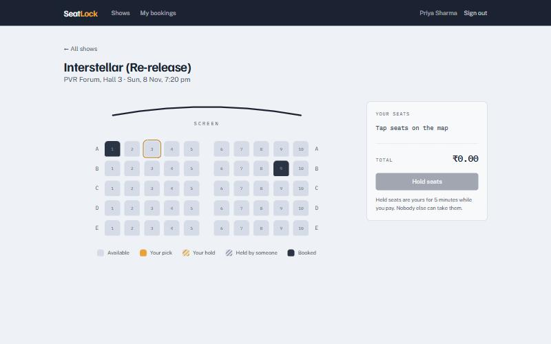
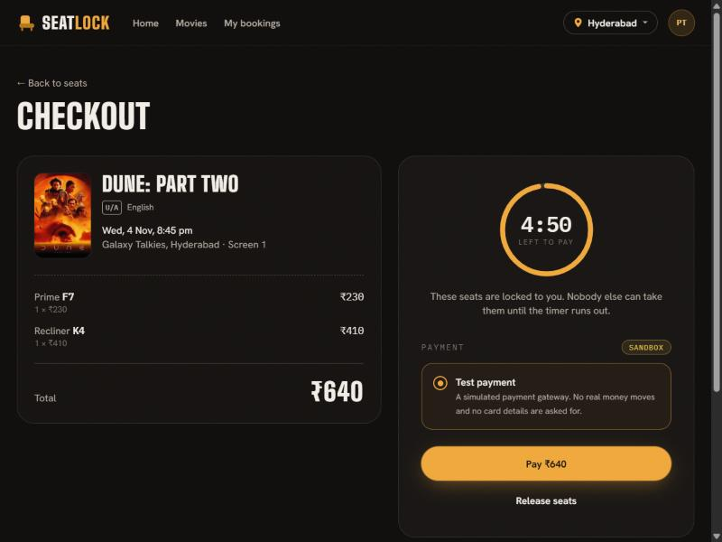
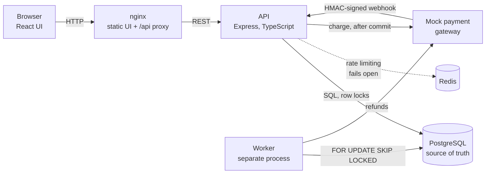
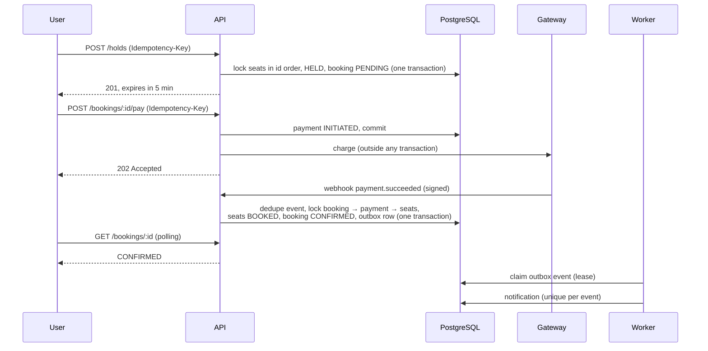
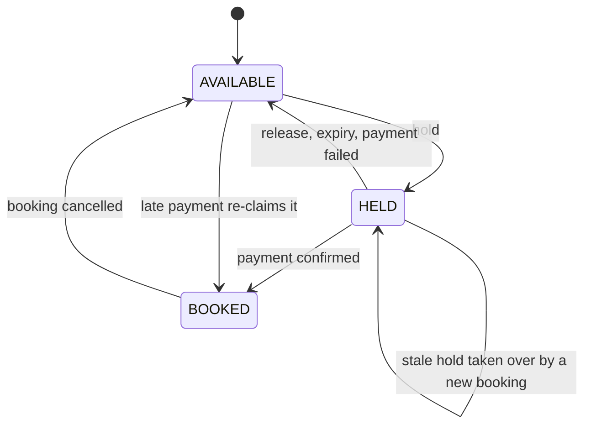
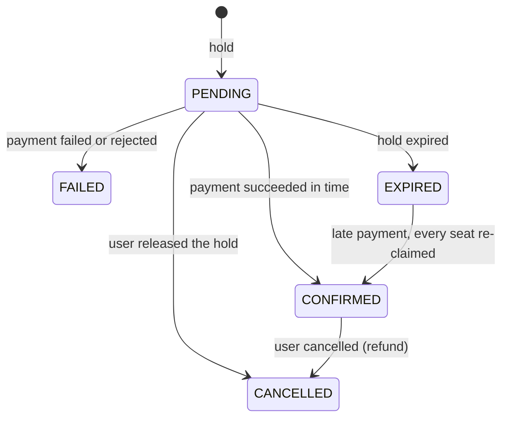
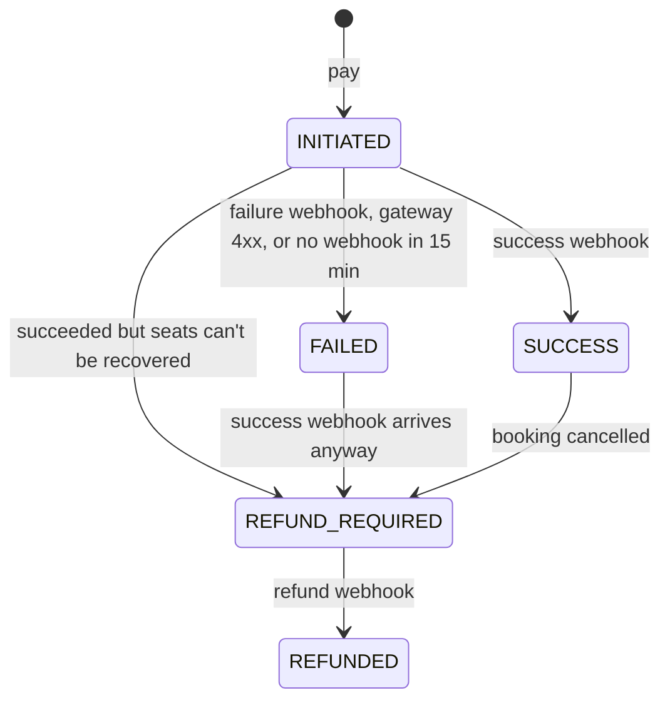
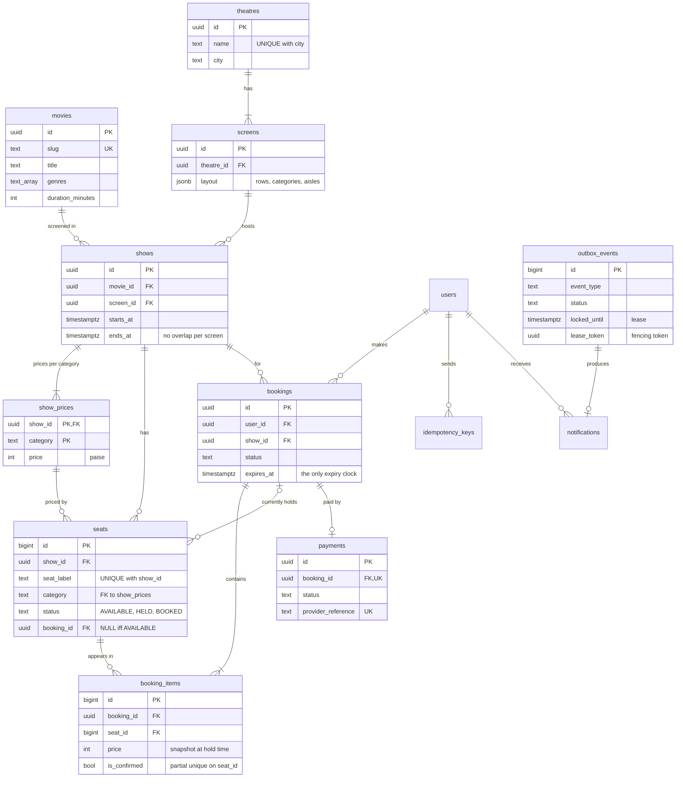

# SeatLock

A ticket-booking backend (BookMyShow-style) built around one guarantee:

> **For a given show and seat, at most one CONFIRMED booking exists at any time, regardless of concurrent requests, retries, crashes or late payments.**

PostgreSQL enforces it with row locks, guarded updates and constraints, not just application code. A partial unique index makes a double-sold seat impossible even if the code has a bug.

[](https://github.com/Saicharan519/SeatLock/actions/workflows/ci.yml)

| Live seat map: hatched seats are held by someone else | Checkout: the hold's countdown comes from the server |
| ----------------------------------------------------- | ---------------------------------------------------- |
|             |            |

## Try it in one command

Requires only Docker.

```bash
git clone https://github.com/Saicharan519/SeatLock.git
cd SeatLock
docker compose up --build
```

Open **http://localhost:8080**, create an account, pick a showtime and seats, pay. The first build takes about 1.5 minutes. The first start on an empty database is healthy in about 20 seconds; later starts take about 11.

`docker compose up` starts seven containers in dependency order: Postgres and Redis, a one-shot job that applies migrations and seeds an admin (`admin@seatlock.local` / `admin12345`) and the demo catalogue (14 films, 7 theatres in 4 cities, a week of showtimes from today), then the API, the worker, the mock payment gateway, and nginx serving the UI and proxying `/api`. The secrets in `docker-compose.yml` are local-demo defaults; override them with environment variables for anything else.

## The bug it prevents

The obvious way to hold a seat is "check it's free, then mark it taken". Raced by 1,000 users for 50 seats ([`npm run demo:race`](demo/race)):

| Implementation        | Customers told "you hold the seat" | Seats that exist |
| --------------------- | ---------------------------------- | ---------------- |
| Naive read-then-write | **524–785**                        | 50               |
| SeatLock              | **50**                             | 50               |

Even the naive version can't actually sell a seat twice here: when it tries to confirm, the database's partial unique index rejects every second confirmation.

A recording of this race and of a late payment is described in [docs/demo-script.md](docs/demo-script.md).

## What's proven

- **1,000 concurrent holds on 50 seats → exactly 50 succeed**, 950 get a clean `409 SEAT_UNAVAILABLE`, zero errors, with same-seat requests genuinely racing (T1, and the k6 spike)
- **Latency targets met** (50 users, 60 s, ~1,000–1,260 req/s): p95 seat map **46–62 ms** (target 300), p95 hold **117–164 ms** (target 500)
- **200 random overlapping multi-seat holds → zero deadlocks**, by Postgres's own counter (T2)
- **The same request sent 20 times at once → one payment and one gateway call** (idempotency keys)
- **Payment-gateway timeouts never fail a booking**; signed webhooks decide, duplicates are no-ops
- **Late payments re-claim all seats or refund**, never partially confirm
- **A worker killed mid-task loses nothing**: its lease expires, another worker re-delivers the event, and the customer still gets exactly one notification (transactional outbox, at-least-once delivery, idempotent consumers)
- **Redis going down doesn't take the API down**: rate limiting fails open, and resumes when Redis returns
- **103 integration tests** against a real PostgreSQL and Redis, green in CI; all 19 PRD acceptance tests (T1–T19) and all 10 core scenarios pass

Measured numbers and machine specs: [docs/results.md](docs/results.md).

## Architecture



The **worker** runs four jobs on a loop: deliver outbox events (notifications, gateway refunds) under leases, expire abandoned holds, fail payments that never got a webhook, and delete old idempotency keys.

- **Three Node processes, one repo:** `apps/api`, `apps/worker`, `apps/mock-gateway`, with shared code in `packages/db` and `packages/shared`. The frontend is a separate package in `frontend/`.
- **Raw parameterized SQL**, no ORM, so locks and atomic updates are explicit.
- **Redis** is used for rate limiting only.

### A booking, end to end



## State machines

Every transition is a **guarded update**: `UPDATE … SET status = new WHERE id = $1 AND status = expected`, with the affected-row count checked. A count of zero means the row was changed by someone else first, and the code handles that explicitly.

**Seat**



**Booking**



**Payment**



A gateway **timeout** changes nothing: the charge may have gone through, so the payment stays `INITIATED` until a webhook (or the 15-minute sweep) decides.

## Database schema



The constraints that carry the guarantees:

| Constraint                                                                      | What it guarantees                                                                      |
| ------------------------------------------------------------------------------- | --------------------------------------------------------------------------------------- |
| `one_confirmed_per_seat`: unique `(seat_id) WHERE is_confirmed`                 | **A seat is in at most one confirmed booking**, even if application code is wrong (T15) |
| `one_pending_per_user_show`: unique `(user_id, show_id) WHERE PENDING`          | One live hold per user per show (no hoarding)                                           |
| `seat_status_owner`: `(status = 'AVAILABLE') = (booking_id IS NULL)`            | A seat's owner always matches its status                                                |
| `shows_no_overlap_per_screen`: exclusion on `(screen_id, [starts_at, ends_at))` | A screen never runs two shows at once                                                   |
| `seats_category_priced`: `(show_id, category)` references `show_prices`         | Every seat has a price for its show                                                     |
| `idempotency_user_key`: unique `(user_id, key)`                                 | Concurrent retries of one request serialize; only one does the work                     |
| `webhook_events` primary key                                                    | A gateway event takes effect once                                                       |
| `notifications_event_unique`                                                    | A redelivered outbox event can't notify twice                                           |

Full DDL: [packages/db/migrations](packages/db/migrations).

## Concurrency rules

These rules (PRD section 9) are followed by every code path, and each is exercised by a test.

| Rule | Statement                                                                                                                                                                  |
| ---- | -------------------------------------------------------------------------------------------------------------------------------------------------------------------------- |
| R1   | Isolation is `READ COMMITTED`. Correctness comes from row locks and guarded updates, not a stricter isolation level                                                        |
| R2   | Seat rows are always locked in **ascending `id` order** (`SELECT … ORDER BY id FOR UPDATE`), in one pass, so overlapping multi-seat holds can't deadlock                   |
| R3   | Global lock order across tables: **booking → payment → seats**                                                                                                             |
| R4   | Deadlock, serialization and lock-timeout errors are retried 3 times with jitter, then `503 RETRY_LATER`                                                                    |
| R5   | All time comparisons use the database clock (`now()`), never the application's                                                                                             |
| R6   | `statement_timeout = 5 s`, `lock_timeout = 3 s`; seat locks block rather than `NOWAIT`, so a loser is never told "unavailable" about a seat whose holder later rolls back  |
| R7   | **No HTTP calls inside a transaction.** The gateway is called after commit; outbox consumers claim under a lease, call out, then record the result in a second transaction |
| R8   | Multi-seat operations are all-or-nothing: if the affected-row count differs from the seat count, the transaction rolls back                                                |

Supporting patterns:

- **Idempotency keys** on hold and pay: the first request does the work and stores its response; retries get the stored response; the same key with a different body gets `422`.
- **Lock, verify, then update** when confirming: lock the booking's seats, check every one is still held by this booking, and only then mark them all `BOOKED`.
- **Stale-hold takeover**: an expired hold the worker hasn't swept yet can be taken over by a new hold, and the sweep later leaves the new owner alone (T19).
- **Transactional outbox**: events are written in the same transaction as the state change, so a crash can't lose them. Leases with a fencing token stop a slow worker overwriting a newer worker's result.

## Decisions and trade-offs

The main ones. The full list, with rejected alternatives and reasons, is in [prd.md section 15](prd.md) and [docs/decisions.md](docs/decisions.md).

- **Postgres row locks, not Redis locks.** The database is already the source of truth; a separate lock service adds failure modes (a lock expiring while the transaction still runs) without adding safety.
- **Pessimistic locking (`FOR UPDATE`), not optimistic version checks.** Contention is the normal case here (everyone wants the same seats), and under heavy contention optimistic retries mostly waste work.
- **A hold is a `PENDING` booking** with one `expires_at`, not a separate holds table: one expiry authority, nothing to drift.
- **Raw SQL, not an ORM**, so every lock and guarded update is visible in the code.
- **A Postgres outbox with in-worker consumers, not Kafka**: the same reliability guarantee with far less to operate. Delivery is at-least-once, so consumers are idempotent.
- **`202` plus webhook for payment**, because real gateways confirm asynchronously, and **a timeout is never treated as failure**, because the money may have moved.
- **Late payment re-claims every seat or refunds**, never partially confirms.
- **The rate limiter fails open**: losing Redis briefly costs abuse protection, not bookings.
- **Known limitations:** one API process tops out at one CPU core, the payment gateway is a mock, and cancellation is whole-booking only. The complete list is at the end of [docs/decisions.md](docs/decisions.md).

## Results

| Measure                         | Result                                                                                          |
| ------------------------------- | ----------------------------------------------------------------------------------------------- |
| Test suite                      | 103 / 103 pass on Windows, in a Linux container, and in GitHub Actions                          |
| T1: 1,000 holds on 50 seats     | Exactly 50 × `201`, 950 × `409`, 0 × `503`                                                      |
| k6 spike: 1,000 users, 50 seats | Always 50 winners, 0 failures, 0 deadlocks; drains in 2.8–4.1 s                                 |
| k6 steady: 50 users, 60 s       | p95 seat map 46–62 ms, p95 hold 117–164 ms at 1,046–1,263 req/s                                 |
| Fresh clone                     | `docker compose up` from an empty folder: built in 85 s, healthy in 20 s, seat booked in the UI |

Details: [docs/results.md](docs/results.md).

## Stack

Node.js 24 · TypeScript · Express 5 · PostgreSQL 16 · Redis 7 · Zod · pino · Jest + Supertest · k6 · Docker Compose · GitHub Actions
UI: React 19 · Vite · Tailwind CSS · nginx

## Developing locally

Requires Node.js 22+ and Docker. Run only the databases in Docker and the apps on your machine, with live reload:

```bash
npm ci
cp .env.example .env
docker compose up -d postgres redis   # Postgres on host port 5433, Redis on 6379
npm run migrate:up
npm run seed
```

Then start the API, worker, mock gateway and UI together in one terminal:

```bash
cd frontend && npm ci && cd ..   # once
npm run dev                      # UI at http://localhost:5173, API on :3000, gateway on :4000
```

(`npm run dev:api`, `dev:gateway`, `dev:worker` and `dev:web` start each piece on its own. The UI proxies `/api` to the API.)

Run the tests (they use a separate `seatlock_test` database):

```bash
npm test
```

The race demo and the k6 load tests (k6 and the API run in Docker; they need a `seatlock_load` database, see [docs/results.md](docs/results.md)):

```bash
npm run demo:race
npm run loadtest:spike
npm run loadtest:steady
```

## API overview

| Method | Path                                                           | Notes                                                                                         |
| ------ | -------------------------------------------------------------- | --------------------------------------------------------------------------------------------- |
| POST   | `/api/auth/register`, `/api/auth/login`                        | Returns a JWT. Rate limited: 10/min per IP                                                    |
| GET    | `/api/movies?city=&genre=&language=&q=`                        | Movies with upcoming-show stats, plus genre and language filter values                        |
| GET    | `/api/movies/:slug`, `/api/movies/:slug/showtimes?city=&date=` | Movie detail; showtimes for one day (IST), grouped by theatre                                 |
| GET    | `/api/cities`                                                  | Cities with upcoming shows                                                                    |
| GET    | `/api/shows`, `/api/shows/:id`, `/api/shows/:id/seats`         | Seat map: screen layout, category prices, live seat status (expired holds count as available) |
| POST   | `/api/holds`                                                   | Hold 1–6 seats for 5 minutes. Requires `Idempotency-Key`. Holds and pay share 30/min per user |
| POST   | `/api/holds/:bookingId/release`                                | Give up a hold                                                                                |
| POST   | `/api/bookings/:id/pay`                                        | `202`; the gateway's webhook confirms. Requires `Idempotency-Key`                             |
| GET    | `/api/bookings/me`, `/api/bookings/:id`                        | History and detail                                                                            |
| POST   | `/api/bookings/:id/cancel`                                     | Whole-booking cancellation with refund                                                        |
| POST   | `/api/webhooks/payment`                                        | HMAC-signed gateway callbacks                                                                 |
| POST   | `/api/admin/movies`, `/api/admin/theatres`                     | Admin only; create catalogue entries                                                          |
| POST   | `/api/admin/theatres/:id/screens`                              | Admin only; a screen with its seat layout (rows, categories, aisles)                          |
| POST   | `/api/admin/shows`                                             | Admin only; a showtime with a price per category; its seats are generated from the layout     |
| GET    | `/api/admin/outbox-events?status=FAILED`                       | Admin only; inspect outbox events                                                             |
| POST   | `/api/admin/outbox-events/:id/retry`                           | Admin only; send a FAILED event back for delivery                                             |
| GET    | `/api/health`                                                  | Database and Redis reachability (Redis down = `degraded`, still 200)                          |

Errors share one shape: `{ "error": { "code", "message", "requestId" } }`.

## Documentation

| Doc                                        | What's in it                                                                |
| ------------------------------------------ | --------------------------------------------------------------------------- |
| [docs/prd-v2.md](docs/prd-v2.md)           | v2 plan (in progress): movies, theatres, real checkout, deployment          |
| [prd.md](prd.md)                           | v1 requirements: concurrency rules, state machines                          |
| [docs/PROGRESS.md](docs/PROGRESS.md)       | Phase status, acceptance-test checklist                                     |
| [docs/decisions.md](docs/decisions.md)     | Every design decision and trade-off, plus known limitations                 |
| [docs/results.md](docs/results.md)         | Measured results and environment                                            |
| [docs/demo-script.md](docs/demo-script.md) | Step-by-step script for the race and late-payment demo                      |
| [docs/phases/](docs/phases/)               | A detailed write-up of each phase: what was built, why, and what went wrong |
