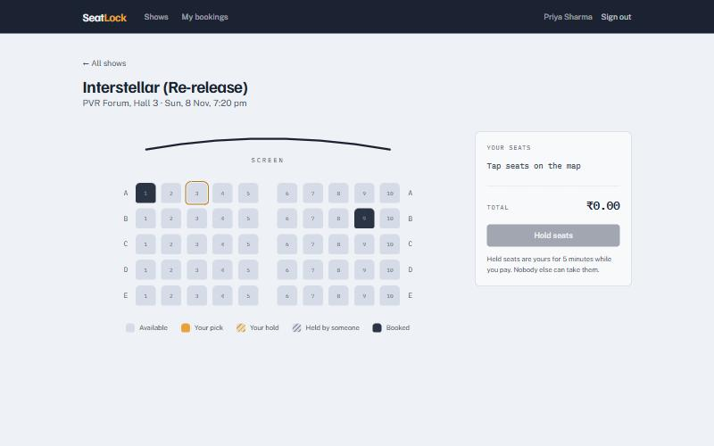
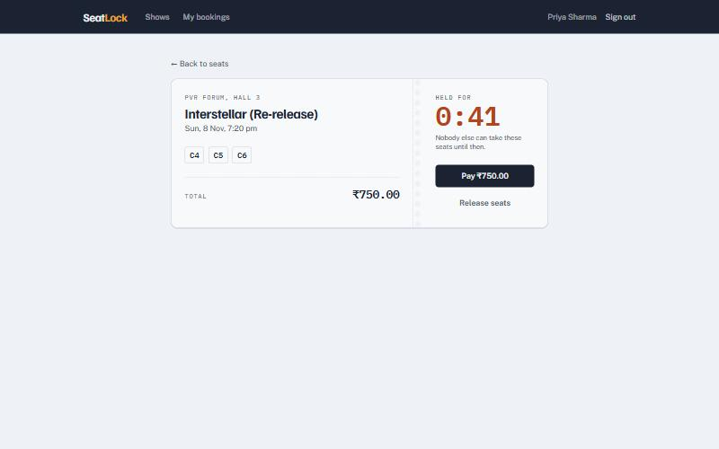

# Phase 9: Minimal frontend

## What this phase is

A small React UI over the finished backend (PRD FR-20, FR-21), capped at three days of effort. Its job is not to be elaborate. It makes the backend's guarantees **visible**: seats changing live as other people hold them, a countdown that belongs to the server, a Pay button that can't charge twice, and a clear screen for every way a booking can end.

## Stack

React 19, Vite 8, Tailwind CSS 4 and React Router 8, in [frontend/](../../frontend). TypeScript 7 in strict mode. In development, Vite proxies `/api` to the API, so the browser talks to one origin and no CORS setup is needed. CI builds it on every push. Production bundle: ~107 KB gzipped.

## Design

A cinema box office. Cool "ticket paper" (`#EEF1F5`) and navy ink, with **marigold reserved for your own seats**. Familjen Grotesk for headings, Public Sans for text, and IBM Plex Mono for seat labels, prices and the timer, like printing on a ticket.

- **The auditorium plan** is the signature: a curved screen line, rows A–E and an aisle. A seat someone else is holding is drawn with **diagonal hatching**, "pencilled in, not sold", so the difference between held and booked is visible at a glance.
- **Checkout is a ticket** with a perforated edge; the stub holds the countdown or the outcome.
- Motion is limited to seats fading between states as the map refreshes, and it's switched off for people who prefer reduced motion.

## Screens and behaviour

| Screen                       | What it does                                                                                                                                                                                                                      |
| ---------------------------- | --------------------------------------------------------------------------------------------------------------------------------------------------------------------------------------------------------------------------------- |
| **Sign in / create account** | JWT stored in `localStorage`; a 401 anywhere signs you out and returns you here                                                                                                                                                   |
| **Shows**                    | Upcoming shows as ticket rows: date, venue, price per seat                                                                                                                                                                        |
| **Seat map**                 | Refreshes every 2 s. Pick up to 6 seats. If someone takes a seat you'd picked, it leaves your selection and you're told ("B5 was just taken by someone else"). Your own live hold is marked as yours, with a link back to payment |
| **Checkout**                 | Countdown from the server's `expiresAt`, turning red in the last minute. Pay, or release the seats                                                                                                                                |
| **Processing**               | Polls the booking every 1.5 s. After 60 s: "This is taking longer than usual… the result will appear in My bookings" (FR-21)                                                                                                      |
| **Outcomes**                 | Confirmed · Payment failed (not charged, seats released) · Hold expired · Refund on its way / Refunded · Released                                                                                                                 |
| **My bookings**              | Live statuses (polled every 3 s, so refunds visibly settle), "Continue to payment" for a live hold, and a two-step cancel ("Cancel and refund ₹500.00?")                                                                          |

**One idempotency key per booking for Pay.** The key is generated once and kept for the session, so a double-tap, or a retry after a dropped connection, sends the same key and the server charges once. Hold requests use a fresh key per attempt, because trying again after a failed hold should really try again.

**Polling pauses in background tabs**, so a forgotten tab doesn't keep calling the API; it resumes within one interval when the tab is visible again.

## How it was verified

Every flow was driven in a real browser against the running API, mock gateway and worker. The API was run with a 45-second hold so expiry could be watched:

| Flow                                            | Result                                                                                                                                                  |
| ----------------------------------------------- | ------------------------------------------------------------------------------------------------------------------------------------------------------- |
| Create an account, sign in                      | Lands on Shows                                                                                                                                          |
| A second user holds C5, C6                      | Hatched as "held by someone" on the map                                                                                                                 |
| Another user takes B5 while it's selected       | Within one refresh: B5 dropped from the selection, the notice shown, button "Hold 1 seat"                                                               |
| Hold, let the timer run out                     | Countdown 0:33 → 0:30 …, then the "Hold expired" screen                                                                                                 |
| Hold, **click Pay twice**, gateway succeeds     | Processing → Confirmed. Database: **1 payment, 1 idempotency key, 1 charge** at the gateway                                                             |
| Gateway declines (402)                          | "Payment failed" immediately                                                                                                                            |
| Gateway fails by webhook                        | Processing → "Payment failed" ~1.6 s later                                                                                                              |
| Gateway answers after 75 s (past the 45 s hold) | "Taking longer" message at 62 s; the late webhook then **re-claimed the seat and confirmed** (Phase 5's late path, through the UI)                      |
| Hold a second time for the same show            | "You're already holding seats for this show. Finish or release that hold first."                                                                        |
| Release seats                                   | Back to the map, seat available again                                                                                                                   |
| Cancel a confirmed booking                      | Two-step confirm → "Cancelled · refund on its way" (0.5 s) → "Cancelled · refunded" (3 s)                                                               |
| Phone width (375 px)                            | Seat map fits (328 px wide, 24 px seats), summary stacks below                                                                                          |
| Keyboard                                        | Tab moves seat to seat with a visible focus outline; held and booked seats are skipped; every seat has a spoken label ("Seat B5, held by someone else") |

## What happened during this phase

1. **Testing found a misleading label.** While Priya held D1, her own seat map called it "held by someone else". The seat map is public and can't say whose hold a seat is under. The page now fetches the user's own live hold for the show alongside the map, marks those seats "held by you" (hatched marigold) and replaces the panel with "Your hold … Continue to payment".
2. **A flash of wrong state.** Before the first seat-map response, every seat rendered as available, so booked seats briefly looked free and clickable. The grid now waits for the first real map.
3. **The seat map didn't fit a phone.** At 478 px it would have scrolled sideways on a 375 px screen. Below the small breakpoint, seats shrink to 24 px with tighter gaps: 328 px, fits.
4. **Copy that stated a number it couldn't guarantee.** "The 5 minutes ran out" was wrong whenever the hold length was configured differently. It now says "Time ran out before payment".
5. **New major versions again:** React Router 8, TypeScript 7 and Vite 8. The router's exports were checked before writing against them.
6. **A tool settings file and a build cache slipped into a commit.** Both were removed from the repository in the next commit and are now ignored.
7. **The first red CI build of the project.** The new frontend job failed with `Cannot find name 'process'` in `vite.config.ts`, yet the build passed locally. Locally, TypeScript found Node's type definitions by walking up into the **parent project's** `node_modules`; CI installs `frontend/` on its own, so they weren't there. The fix (adding `@types/node` to the frontend) was proven, not guessed: the committed version was built in an isolated Linux container holding only `frontend/` and failed with the identical error, then the fixed version passed the same way. CI's actions were also moved to v5, off the deprecated Node 20 runtime. Lesson: a package must declare everything it uses; inheriting from a parent folder is a hidden dependency.

## Key takeaways

- The UI makes concurrency visible: live seat states, hatched holds versus solid bookings, and a server-driven countdown.
- Idempotency reaches the user: one key per booking makes double taps harmless, verified as one payment in the database.
- Every terminal state has its own screen with a next step, including the uncommon ones (late refund, released).
- Testing in a real browser against the real stack found problems no unit test would have: a misleading label, a flash of wrong state, and a layout that didn't fit a phone.
